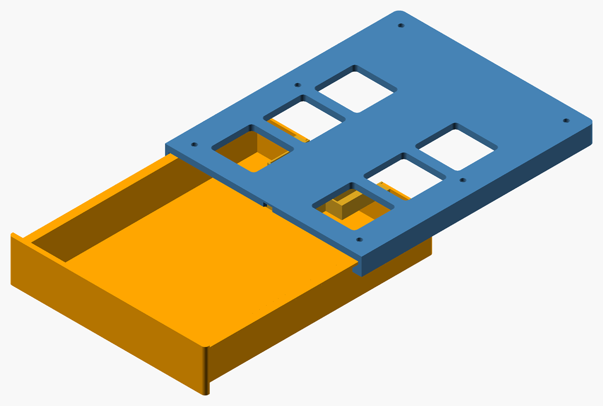
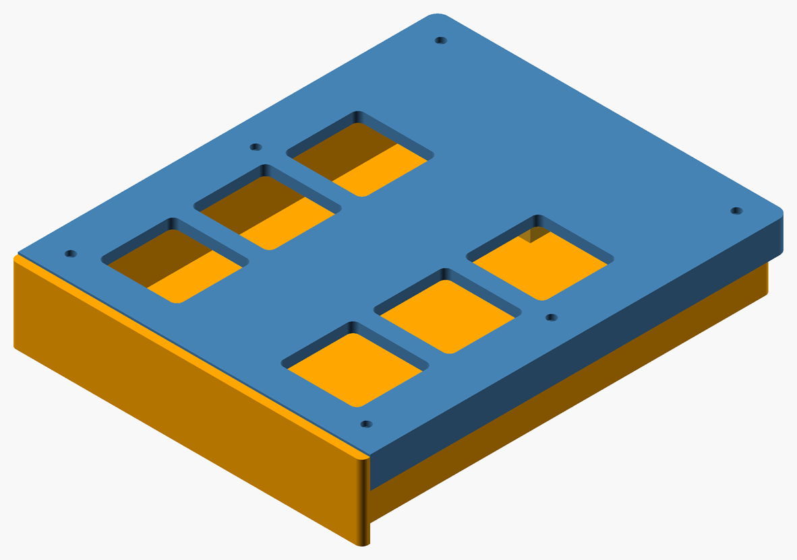
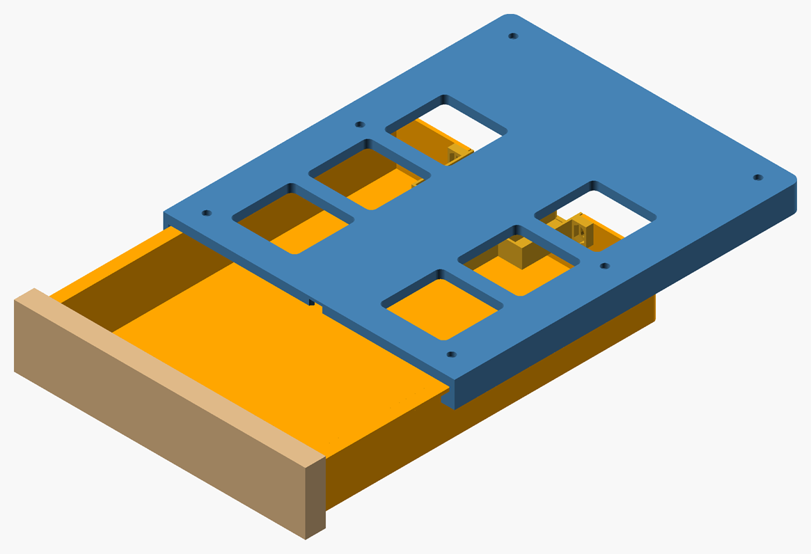
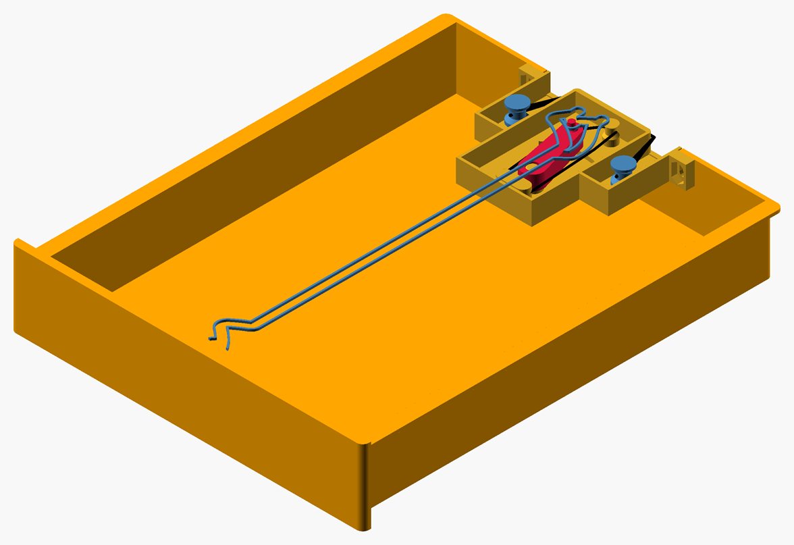
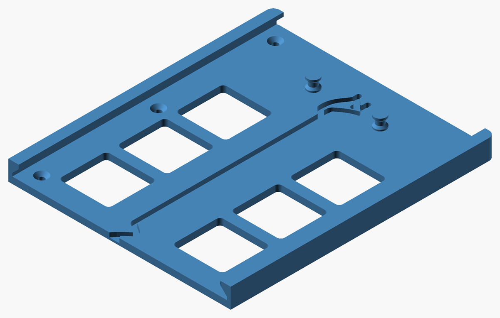
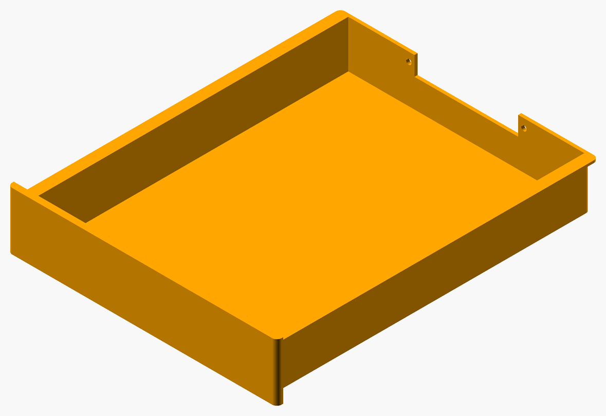
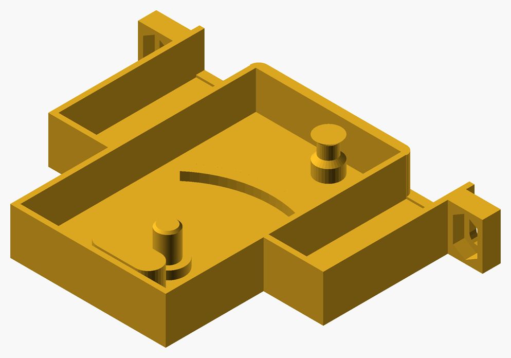
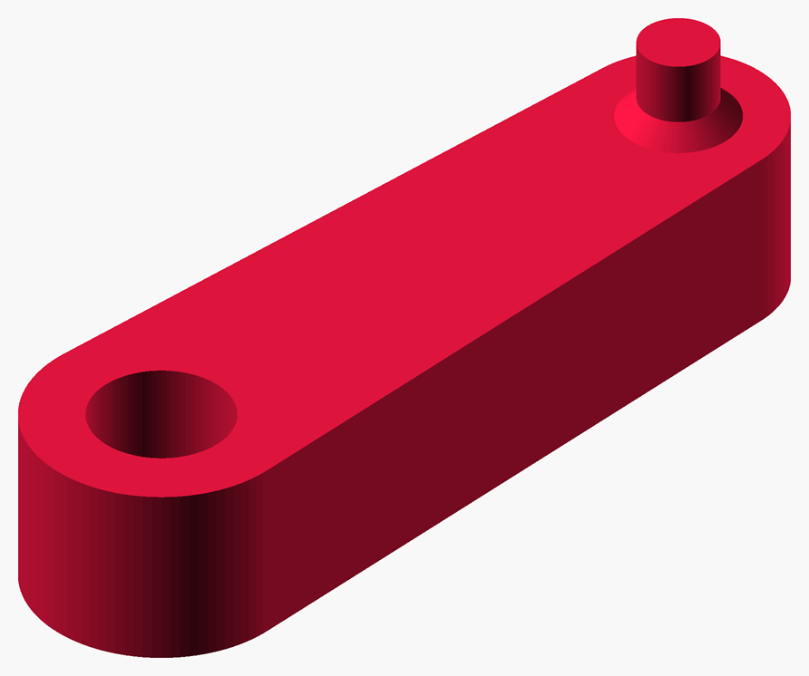
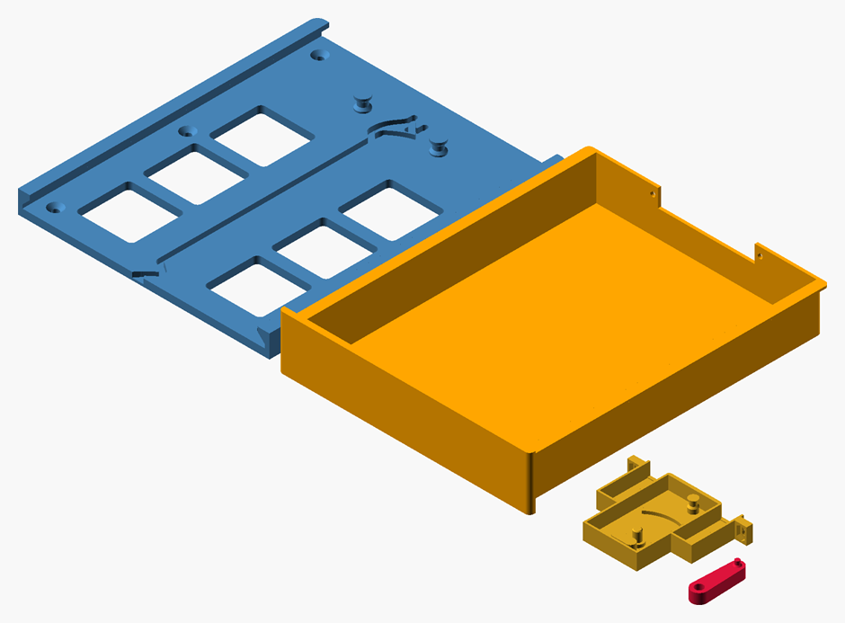

# Parametric Under-Desk Drawer (push-to-open)

An OpenSCAD drawer that screws under a desk and prints with no supports. Push the front to latch it; push again and a rubber band pops it open.



| closed | with a wood face (`wood_face`, `panel_t = 0`) |
|---|---|
|  |  |

The latch and kicker with the drawer latched, the housing shown as just its groove and posts:




`underdesk_drawer.scad`: open it in OpenSCAD (nightly, with the Manifold backend). Set the size in the Customizer, then pick `part`.

`part = assembly` shows the drawer assembled in F5 preview; F6 renders all the parts laid out for printing (`print_layout` shows that layout in F5). The `assembly_open_pct` slider pulls the drawer out (100% leaves 15 mm in the housing). The pin stays in the groove on its way-out path, as after a release, and the latch arm swings to match.

`part = animation` animates one full latch cycle: latched → push → pops out to where the ejector leaves it → pulled up to the pull-out catch → pulled over it, until the pin leaves the plate → pushed back in over the catch's ramp → latched again. (With `catch` off it goes back in from where the ejector leaves it.) The pin follows the groove, the arm swings with it, and the rubber bands are drawn too. The housing is drawn as just its groove outline and kicker posts, so nothing hides the arm. `animation_drawer` can be `solid` or `ghost`. Press F5, then open the Animate panel: Window → Animate in recent OpenSCAD (View → Animate in 2021.01). Set FPS and Steps there, for example 15 and 200.

| part | print orientation | notes |
|---|---|---|
| `housing` | desk face down on the bed (already exported that way) | slide ledges, latch groove, screw holes, the two kicker posts |
| `drawer` | floor on the bed | a plain box: lips, front panel, and a notch in the back wall for the cassette (with its bolt holes) |
| `cassette` | tray on the bed | latch pocket, the arm's pivot post and tip support, latch band posts and kicker bays on one flat tray; its back wall is the kicker's nose |
| `arm` | flat on the bed, pin up | rigid latch arm that carries the pin |

| housing | drawer |
|---|---|
|  |  |
| **cassette** | **arm** |
|  |  |

All four as `print_layout` sets them out:




The Customizer only has the choices a builder makes: the drawer's size and walls, the wood face, the housing, the mounts, the bands and the fit clearances. Everything else (the latch, its arm, the catch, the slide) is a fixed number in the file's `[Hidden]` section, because those work together; `-D name=value` still overrides them.


## How it works
- **Slide:** 45° lips on the drawer rest on 45° ledges in the housing. This works like a dovetail. It centres the drawer side to side, and both parts print with no overhang steeper than 45°. If the print comes out a little wider or narrower, the drawer just rides slightly higher or lower.
- **Latch:** a push-push "heart cam" groove is cut into the housing plate. The pin that runs in it sits on a rigid arm in a pocket on the cassette, at the back centre of the drawer. The arm swings sideways on a post at its front end, so the cam can push it sideways without it tipping or jamming, and the push of the latch goes straight along the arm into the post. One rubber band is stretched lengthwise around a spreader in front of the arm's hub and a post behind its tip, with the arm sitting between its two strands. When the arm swings, its rounded tip pushes one strand out like a bowstring, and the band pulls it back to centre. At rest both strands press lightly on the tip, so there's no dead zone in the middle. No printed part has to flex. The pin moves on a slight arc, so the groove is drawn with that correction. The latch is centred, so it pulls straight and doesn't twist the drawer on the slide. The cycle is: push in → latch (the drawer sits about 7.5 mm proud) → push about 5 mm or more → release. On the way out after release, the groove steers the pin back across on a smooth S-curve (no corners, at most about 36° off straight) rather than a sharp 45° bend, so the drawer doesn't stutter there. Every other bend in the groove is rounded too, on arcs of 1.4–3 mm radius (the pin-centre path, as in the prior art below). The only sharp points left are where the groove's paths meet: the notch the pin rests in, the two stroke ends, and the mouth. Those points decide which way the pin goes, so they stay sharp. That swing stretches the latch band, so the curve does most of it early, while the ejector still pushes hard, and the last stretch to the groove's mouth lets the latch band push the drawer out instead.
- **Cassette:** the whole latch mechanism and the kicker's bays on one printed tray. It's a separate part from the drawer, so it prints flat with nothing hanging in the air. It sits in a notch in the top of the drawer's back, with its tray just under the arm; its back wall fills the notch, flush with the outside, and is the nose the kicker band pushes on. That back is one shallow curve across its width (its corners 4 mm forward of its middle, rounded on 5 mm radii into the sides), so the band bears on the whole of it, not on two sharp corners. A lip round its top flares out over the band at 45° (1.5 mm, like the posts' flares), so a loose or oversized band can't ride up over it into the latch pocket. That lip is the only thing that sticks out behind the drawer's back, by 1.5 mm. The cassette is the same part for every drawer: its size depends on nothing but its own mount (`cassette_mount`, `cassette_bolt`, which shape the ears and back), so one you have printed fits any other drawer made with the same mount. For the same reason the drawer's back wall is always 2 mm, whatever `wall` is, and the housing's kicker posts are always 51.5 mm apart. The latch and kicker forces stay inside the cassette: the band pushes the nose, and the pin holds the arm, which is on the same part. An ear on each side sits against the inside of the drawer's back. `cassette_mount` picks how it's held:
  - `captive_nut` (default): a bolt from outside through the back into a nut held in a hex slot in each ear. The slot keeps the nut from turning and lets it slide up and down, so you can set the cassette's height before tightening. `cassette_bolt` sets the size (M2.5, M3, M4, M5; default M3).
  - `normal`: the same bolts through vertical slots in the ears, with loose nuts.
  - `mortise`: no hardware. The cassette's back wall is a dovetail (20° off square, with a `mortise_clr` gap) that drops into a matching notch and rests on its floor. The dovetail stops it moving forward, and the ears stop it moving back. The notch floor sets its height.
- **Pull-out catch:** the groove's straight run to the housing's front has a jog in it, so an open drawer stops before it comes right out. It needs no extra part: the latch arm and its band are the spring. Pulling takes the pin up a steep face (60°); pushing the drawer back in takes it up a 45° ramp. With a 2 N latch band that's roughly 3 N to pull it out and 1.3 N to put it back, and the console prints the estimate for your settings. It's a nudge, not a lock: a firm pull or a fast, heavy drawer goes past it. The drawer stops with about 35 mm of its back still in the housing, so the smallest depth with the catch is 100 mm, which opens 69 mm of 104. Turning `catch` off leaves it out, and allows depths down to 62 mm.
- **Ejector, the kicker:** one short band on two posts that hang from the housing plate, one on each side of the cassette. It is always a little stretched around them (1.2× with the drawer open), so it is never slack. It never hooks onto the drawer, so there is nothing for it to fall off. Over the last 36 mm of closing, the cassette's curved back pushes the middle of the band back into a V; released, the band pushes the drawer out again and lets go of it. Each post runs in a notch cut into the top of the cassette's back (about 8 mm deep), inside a small walled bay beside the pocket so nothing in the drawer sits in its way. The band has to still be pushing when the latch pin leaves its groove, about 26 mm out. Otherwise the drawer stops with the pin still on its way out and needs a pull before it latches again.
  - The band is always a 2" one (51 mm flat), because the posts are the same distance apart on every drawer. It sits on them at 1.2× its length and is stretched to 2.1× with the drawer closed. Only its strength is yours to choose: a wider band pushes harder. 1/16" wide is about 2 N, the default `kicker_band_n`. These are the console's rough figures for an empty printed drawer with a 2 N band:

    | drawer (interior, mm) | rough weight | coasts open to | still resets with up to | strength that suits it empty |
    |---|---|---|---|---|
    | 120 × 100 × 30 | 131 g | can throw itself out | 920 g inside | 0.8 N |
    | 150 × 200 × 30 | 216 g | 125 of 204 mm | 840 g | 1.2 N |
    | 200 × 150 × 40 | 252 g | 107 of 154 mm | 800 g | 1.4 N |
    | 400 × 200 × 20 | 400 g | 68 of 204 mm | 650 g | 2.2 N |
    | 300 × 300 × 60 | 606 g | 45 of 304 mm | 450 g | 3.2 N |

  - Once the band lets go, mostly friction stops the drawer; the pull-out catch only takes a little off a drawer that gets that far. The console warns if your band could throw the empty drawer out, and says what strength it would rather have. Its numbers are rough (estimated weight, PLA-on-PLA friction 0.3), so try it before filling the drawer. A heavier load stops it shorter; if it stops before the latch resets, a short pull resets it.
  - Small, light drawers are the weak spot. Below about 150 g a 2 N band can throw the empty drawer out (the console warns); the smallest one (84 × 100 × 17 mm, about 80 g) wants about 0.4 N, weaker than you can usually buy. Use the thinnest, weakest band you have, or keep some weight in the drawer.

## Wood face
The drawer is printed, but its front can carry a wood face. Turn on `wood_face` and the front gets countersunk holes for wood screws from inside the drawer: 12 mm in from each side wall, more in between on drawers wider than about 225 mm, and two rows when the inside is 50 mm or taller. `wood_face_screw` picks the size (#6 by default), and the heads sit just below the surface.

- With a printed front panel, that panel is still what stops the drawer against the housing, so the wood doesn't affect the latch. Set `panel_t = 0` to leave the panel off and screw the wood straight onto the box: the wood is then the stop, so its back must be flat and it must reach past the opening onto the housing's side walls. The screw heads stick out a little on the inside, because the wall alone is too thin to sink them. Without a wood face, `panel_t = 0` leaves the drawer with no stop but the latch pin, and the console warns.
- The wood can be any size. The console prints the size that just covers the printed front (or the housing); make it bigger to overhang the housing, but keep its top edge off the desk.
- Set `wood_face_t` to the wood's thickness. The console prints the longest screw that won't come through (the printed front plus the wood, less 2 mm), and the wood's weight (0.6 g/cm³, as big as the printed front) counts in the kicker band estimates. A bigger or denser face weighs more and wants a stronger band.
- Put the face on before the cassette goes in. Tape it in place, drill pilot holes through the printed ones, and screw it on. In a short drawer a driver only fits at an angle; use a stubby or right-angle one.

## Hardware
- Countersunk wood screws: 4 for small drawers, more for long ones (the console prints the count; `screw_spacing` sets the most space allowed between screws along each side, default 100 mm, so a 200 mm deep drawer gets 6). #8 / 4 mm by default (pick #6, #8, #9 or #10 with `screw`). Length = desk thickness minus a few mm + 5 mm (the plate)
- Ejector: 1 rubber band for the kicker, 2" (51 mm) flat length, 1/16" wide (a #14) to start with; a wider one for a heavy drawer
- 1 rubber band for the latch (size printed in the console; default: about 77 mm around / 39 mm flat, e.g. a #10 to #12 band, or a smaller one doubled)
- Wood face (optional): countersunk wood screws, #6 by default (the console prints how many and how long)
- Cassette: 2 bolts and nuts, M3 by default (about 10 mm long), unless `cassette_mount = mortise`

## Print settings
- No part flexes, so PLA or PETG both work for every part.
- Print the arm with at least 3 perimeters so the pin is solid.
- Wide, flat parts (the housing and the drawer) can curl off the bed at their corners, PLA included. Their vertical corners are rounded to make that less likely (not the housing's front ones, which the front panel stops against). On top of that, print those two with a 5–8 mm brim, certainly from about 200 mm a side; sparse infill and no drafts help too.

## Minimum sizes
The smallest drawer is **84 mm wide, 100 mm deep, 17 mm tall** (interior); anything lower is raised to that, with a warning. The width is the room for the kicker's posts and the cassette's ears on each side of the latch. That's with M3 captive nuts: bigger bolts need a little more, and `mortise` a little less (about 80 mm). The depth lets the drawer open about two thirds of the way before the pull-out catch stops it (69 of 104 mm); with `catch` off it can be as little as 62 mm, which comes from the latch arm and its band (spreader to back post). The height leaves 5 mm of back wall under the cassette's notch.

## Install
1. Screw the housing to the desk. All screws are reachable from below with the drawer out.
2. Put the cassette in its notch in the drawer's back. `captive_nut`: push a nut into each ear's hex slot and bolt through from outside. `normal`: bolt through with loose nuts on the inside. `mortise`: slide it straight down into the dovetail. Set its top flush with the rim before tightening.
3. Stretch the latch band around the spreader (front of the pocket) and the post behind it, so it forms a long loop. Spread the strands apart and drop the arm's hub onto the pivot post between them; the band sits on either side of the arm's rounded tip. Nothing needs threading, so a doubled band is just as easy.
4. Stretch the kicker band around both posts (between their flares) before you put the drawer in. It stays there, even when you take the drawer out.
5. Slide the drawer in. The funnel at the plate's front edge guides the pin into its groove, and the drawer clicks over the pull-out catch. To take it out again, pull firmly past the catch.

## Tuning (Customizer)
- Slide too tight or too loose: `slide_clr`, `side_clr`.
- Arm sticks or wobbles on its pivot: `arm_clr`. Latch feels stiff or weak: use a looser or tighter latch band.
- Latch won't engage or release reliably: `pin_clr` (it widens the groove; the cassette and arm stay the same). If you change the cam numbers, re-check them with `tools/camsim.ps1` (see below).
- Drawer stops short and needs a pull before it latches again: use a stronger kicker band, or check the [energy map](#energy-map) for an uphill stretch.
- Ejection too weak or too violent: use a wider or narrower 2" band. Set `kicker_band_n` to its strength for the console's estimate of how far the empty drawer coasts.
- Pull-out catch too weak or too stiff: use a weaker or stronger latch band, or change the fixed `catch_angle` in the file a few degrees at a time (friction makes it climb fast; past about 70° it may not let go at all).
- Mortise cassette too tight or loose in its notch: `mortise_clr`.

## Energy map
A drawer only runs by itself while the rubber bands' total stored energy keeps going down, because a band won't climb back up an energy hill. It is a design check, not part of setting up a drawer, so it isn't in the Customizer. Run it after changing the groove, the latch band's posts or the kicker's stroke; it prints that total through one cycle (no geometry):
```
openscad -o energy.echo -D 'part="energy_map"' underdesk_drawer.scad
```
It works each band's stretched length out from the real geometry: the latch band's two strands around the arm tip, and the kicker's band from its posts round the back of the cassette. It also estimates how far the empty drawer coasts after the band lets go, and how much it can carry and still reset. It lists:
- the latch band's and the ejector's energy at the key points (latched, released, the exit curve, the arm's furthest swing, the pin leaving the groove, the kicker letting go);
- the two runs that have to happen on their own: released → open, and let go after the first push → into the notch. Each is either "downhill all the way", with the smallest net push left (in N) and the push as the pin leaves the groove, or a WARNING naming each uphill stretch, where the drawer stops unless momentum carries it.

Set `latch_band_n` and `kicker_band_n` to your bands' strength: the pull in N it takes to stretch one to twice its length (100 g ≈ 1 N). It treats a band as a linear spring with no friction, so read the numbers as a comparison, not exact forces. For example, an old 25 mm stroke showed uphill from 25.5 to 28.6 mm out: the band was relaxed before the pin left the groove, which is why the drawer had to be pulled out the last bit before it would latch again.

## Latch verification
`tools/camsim.ps1` sends a finite-size pin through the real groove geometry over repeated push/release cycles, with a strong, a weak and no centring spring (the latch band). It models the arm: the pin swings on an arc, as it does on the real part. Dump the geometry, then run it:
```
openscad -o dump.echo -D 'part="cam_paths"' underdesk_drawer.scad
powershell -ExecutionPolicy Bypass -File tools\camsim.ps1 -dump dump.echo
```
Results for the current geometry:
- Latch and release work with both the strong and the weak spring. With no spring at all it stays latched, which is why the latch band is needed.
- With the panel stop off by ±0.8 mm, it still works.
- A partial push from latched (1.5 mm or 4 mm) re-latches; 5.5 mm releases. The catch is deep, so the spring alone can never pull the pin out of the notch.
- `tools/camsim_rest_offset.ps1` shows it still works if the arm comes to rest off-centre by -0.25…+2 mm (pivot friction, an uneven band). The band aims it at about the middle of that window.
- `tools/cammargin.ps1` checks the one thing the slow-motion simulation can't: momentum. On the way out after the first push, the band pulls the pin toward the exit side. A fast-swinging arm, a drawer that bounces, or play in the pivot can carry it over the catch, especially when the unit isn't level, because then nothing presses the arm onto its post to damp it. The tool finds the smallest amount the drawer would have to move back in, part-way through that return, for the pin to skip the catch: **2.3 mm** (the earlier groove had 0.66 mm, and 2.1 mm before its corners were rounded). The return path drops straight for a while before turning toward the notch, and the exit ramp climbs higher.
  ```
  powershell -ExecutionPolicy Bypass -File tools\cammargin.ps1 -dump dump.echo
  ```

## Prior art
Notes from patents on commercial push-push latches (read November 2026), and how this design compares. None of them give dimensions, so every number in this design still comes from the tools above.
- **Southco, US 6247733 (push-push latch with clicker):** a heart-shaped groove cut into a shuttle that pivots freely, off-centre. The incoming pin hits a ramp, which turns the shuttle and steers the pin into the catch. The steering comes from the walls alone: no steps in the floor and no spring on the shuttle. This is the closest relative of this design (here the arm pivots instead of the cam), and it shows that walls alone can steer reliably. Its walls are continuous curves; this groove used to be straight legs meeting at corners, and now it rounds them the same way. A wire-sprung fork clicks as the pin passes, so you hear it latch. This design has nothing like that.
- **Alcon, EP 4687688 A1 (robust push-push connector):** a rigid arm on a pivot carries a pin around a triangular track. It explains that earlier arms, which bent sideways to follow the track, were fragile. So the arm is rigid, and a torsion spring preloads it against one wall of the track at all times, which takes out play and bounce. This design uses the same idea: a rigid arm, with the latch band pressing on its tip even at rest.
- **GM, US 9895969 (push-push latch):** guide ridges in the track floor, with the pin held down onto them by a flexing bridge. The ridges, not the walls, decide which way the pin goes, so a bounce can't send it the wrong way. Lifting the pin above the ridges traps it, which is how this latch locks. The downside is that something has to press the pin onto the floor. This design has no floor steps; `tools/cammargin.ps1` measures how well it resists bounce instead.
- **Alps, US 4916276 (push lock):** the failure it fixes is someone pulling while the latch is engaged. That loads the pin against the groove, and in earlier designs it eventually broke the groove or bent the pin. Its fix is to connect the handle to the latched part through a weaker spring, so a pull moves the handle without loading the pin. In this design a pull on a latched drawer goes straight into the pin. Pulling a stalled drawer was also how the old version had to be reset; since b48a9b1 the ejector keeps pushing until the pin has left the groove, so that pull isn't needed.
- **A printed push latch on MakerWorld (model 2403525)** replaces its plastic actuator arm with a steel paperclip, because a plastic arm that stays bent takes a set over time. In this design no printed part stays bent, and the latch band does the springing. Rubber bands relax with age too, though, so keep the energy map's leftover push comfortable.

**Not yet physically tested.** Expect to tune clearances on the first print.
